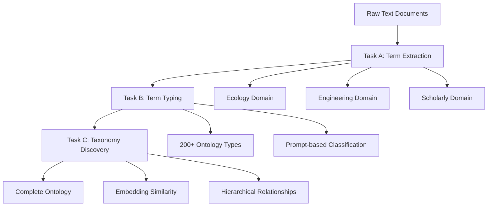

# LLMs4OL Challenge - Documentation

Welcome to the comprehensive documentation for the **LLMs4OL Challenge** submission for ISWC 2025. This documentation provides complete coverage of all public APIs, functions, components, and usage patterns in the system.

## 📋 Documentation Overview

This documentation suite consists of four main documents that cover different aspects of the system:

| Document | Purpose | Audience |
|----------|---------|----------|
| **[API Reference](API_REFERENCE.md)** | Complete API specifications and function signatures | Developers integrating with the system |
| **[Usage Guide](USAGE_GUIDE.md)** | Step-by-step instructions and practical examples | Users implementing the system |
| **[Component Documentation](COMPONENT_DOCUMENTATION.md)** | Detailed technical architecture and implementation | System architects and maintainers |
| **[Examples](EXAMPLES.md)** | Real-world use cases and comprehensive examples | All users seeking practical guidance |

## 🚀 Quick Start

### For New Users
1. Start with the **[Usage Guide](USAGE_GUIDE.md)** for installation and basic examples
2. Review **[Examples](EXAMPLES.md)** for complete end-to-end workflows
3. Refer to **[API Reference](API_REFERENCE.md)** for specific function details

### For Developers
1. Study **[Component Documentation](COMPONENT_DOCUMENTATION.md)** for system architecture
2. Use **[API Reference](API_REFERENCE.md)** for integration specifications
3. Check **[Examples](EXAMPLES.md)** for implementation patterns

### For System Architects
1. Review **[Component Documentation](COMPONENT_DOCUMENTATION.md)** for design principles
2. Examine **[Examples](EXAMPLES.md)** for integration scenarios
3. Reference **[Usage Guide](USAGE_GUIDE.md)** for deployment patterns

## 🏗️ System Architecture

The LLMs4OL Challenge system implements a three-stage pipeline for ontology learning:



### Core Components

#### Task A - Text2Onto
- **Purpose**: Extract domain-specific terms from raw text
- **Domains**: Ecology, Engineering, Scholarly
- **Models**: Gemini, LLaMA, various LLM providers
- **Output**: Structured term lists with metadata

#### Task B - Term Typing  
- **Purpose**: Assign ontology types to extracted terms
- **Types**: 200+ scientific and domain-specific categories
- **Method**: Comprehensive prompt-based classification
- **Output**: Terms with assigned type labels

#### Task C - Taxonomy Discovery
- **Purpose**: Discover hierarchical "is-a" relationships
- **Method**: Embedding-based similarity matching
- **Features**: Confidence scoring and validation
- **Output**: Parent-child relationship taxonomy

## 📊 Key Features

### Multi-Domain Support
- **Ecology**: Biodiversity, ecosystems, environmental science
- **Engineering**: Manufacturing, materials, processes, measurements
- **Scholarly**: Research methods, academic terminology, analysis

### Robust Processing
- **Error Handling**: Comprehensive retry mechanisms and graceful degradation
- **Scalability**: Batch processing and efficient file handling
- **Flexibility**: Multiple model support and configurable parameters

### Rich Output Formats
- **JSONL**: Streaming document processing
- **JSON**: Structured data with relationships
- **TXT**: Simple lists and reports

## 🛠️ Available Tools and Utilities

### File Processing
- **Chunker**: Split large datasets into manageable pieces
- **Cleaner**: Remove duplicate and invalid relationships
- **Unique Extractors**: Deduplicate terms and relationships

### Analysis Tools
- **Token Overlap**: Calculate similarity between terms
- **Embedding Similarity**: Semantic similarity measurement
- **Confidence Scoring**: Assess relationship quality

### Integration Utilities
- **Multi-domain Processing**: Handle multiple domains simultaneously
- **Incremental Updates**: Add new data to existing ontologies
- **Cross-validation**: Verify relationships across different methods

## 📖 Documentation Structure

### [API Reference](API_REFERENCE.md)
**Complete technical reference for all public APIs**

- Function signatures and parameters
- Return types and data structures  
- Configuration options and examples
- Error handling and exceptions
- Performance characteristics

**Key Sections:**
- Task A APIs (all domains)
- Task B classification APIs
- Task C embedding and taxonomy APIs
- Utility function specifications
- Configuration and setup guides

### [Usage Guide](USAGE_GUIDE.md) 
**Practical guide with step-by-step instructions**

- Installation and setup procedures
- Basic usage examples for each task
- Advanced configuration options
- Complete workflow implementations
- Best practices and optimization tips

**Key Sections:**
- Quick start tutorial
- Task-specific examples
- Integration patterns
- Performance optimization
- Error handling strategies

### [Component Documentation](COMPONENT_DOCUMENTATION.md)
**Detailed technical architecture and design**

- System architecture overview
- Component interaction patterns
- Data flow and processing pipelines
- Implementation details and algorithms
- Performance monitoring and metrics

**Key Sections:**
- Architecture principles
- Component specifications
- Integration patterns
- Data formats and structures
- Performance considerations

### [Examples](EXAMPLES.md)
**Comprehensive real-world use cases and examples**

- Complete end-to-end workflows
- Domain-specific implementations
- Integration scenarios
- Custom adaptation examples
- Advanced use case patterns

**Key Sections:**
- Marine biology ontology development
- Multi-domain integration
- Custom domain processing
- Incremental ontology updates
- Specialized terminology handling

## 🎯 Use Case Examples

### Academic Research
```python
# Extract terms from research papers
papers = load_scholarly_documents("research_corpus.jsonl")
terms = extract_terms(papers, domain="scholarly")
types = classify_terms(terms, focus="methodology")
taxonomy = build_taxonomy(types)
```

### Industrial Applications  
```python
# Process engineering documentation
docs = load_engineering_specs("manufacturing_docs.jsonl")
technical_terms = extract_technical_terms(docs)
classifications = classify_engineering_terms(technical_terms)
process_hierarchy = discover_process_relationships(classifications)
```

### Environmental Science
```python
# Build ecology ontology from field studies
field_data = load_ecology_documents("ecosystem_studies.jsonl")
biological_terms = extract_biological_terms(field_data)
organism_types = classify_biological_entities(biological_terms)
ecological_taxonomy = build_ecological_hierarchy(organism_types)
```

## 🔧 Configuration and Customization

### Model Configuration
```python
# Configure different models for different domains
ecology_config = {
    "model": "google/gemini-2.5-flash-preview-05-20",
    "domain": "ecology",
    "max_tokens": 4096
}

engineering_config = {
    "model": "meta-llama/llama-3.3-70b-instruct", 
    "domain": "engineering",
    "temperature": 0.1
}
```

### Custom Domain Setup
```python
# Add support for new domains
medical_domain = {
    "name": "medical",
    "prompt_examples": medical_examples,
    "type_categories": medical_types,
    "validation_rules": medical_validators
}

register_domain(medical_domain)
```

### Pipeline Customization
```python
# Customize processing pipeline
custom_pipeline = Pipeline([
    TermExtractor(domain="custom", model="your-model"),
    CustomTypeClassifier(categories=custom_types),
    EmbeddingTaxonomyBuilder(threshold=0.8),
    QualityValidator(confidence_threshold=0.75)
])
```

## 📈 Performance and Scaling

### Processing Capabilities
- **Document Throughput**: 100-1000 documents per hour (model dependent)
- **Term Processing**: Up to 10,000 terms per batch
- **Taxonomy Scale**: Handles hierarchies with 1000+ relationships

### Resource Requirements
- **Memory**: 4-8GB RAM for typical workloads
- **Storage**: Efficient file-based processing with minimal storage overhead
- **API Calls**: Built-in rate limiting and retry mechanisms

### Optimization Strategies
- **Batch Processing**: Group operations for efficiency
- **Caching**: Reuse embeddings and classifications
- **Parallel Processing**: Multi-domain simultaneous processing
- **Incremental Updates**: Add new data without full reprocessing

## 🐛 Troubleshooting and Support

### Common Issues
1. **API Rate Limits**: Configure delays and retry strategies
2. **Memory Usage**: Use chunking for large datasets
3. **Model Errors**: Check API credentials and model availability
4. **Format Issues**: Validate input data formats

### Debug Tools
```python
# Enable detailed logging
import logging
logging.basicConfig(level=logging.DEBUG)

# Validate data formats
from utils.validation import validate_input_format
validate_input_format("your_data.jsonl")

# Test API connectivity
from utils.health import test_api_connection
test_api_connection(client_config)
```

### Performance Monitoring
```python
# Monitor processing performance
from utils.metrics import ProcessingMetrics

metrics = ProcessingMetrics()
with metrics.track("term_extraction"):
    results = extract_terms(documents)

print(f"Processing time: {metrics.get_duration('term_extraction')}")
print(f"Throughput: {metrics.get_throughput('term_extraction')}")
```

## 🤝 Contributing and Extension

### Adding New Domains
1. Create domain-specific prompt examples
2. Define domain type categories
3. Implement domain validation rules
4. Add domain to configuration

### Custom Models
1. Implement model adapter interface
2. Add model configuration
3. Test with domain-specific data
4. Update documentation

### Integration Patterns
1. Use provided base classes
2. Follow established error handling patterns
3. Implement proper logging
4. Add comprehensive tests

## 📚 Additional Resources

### Research Background
- **Challenge Description**: [LLMs4OL Challenge @ ISWC 2025](https://llms4ol.github.io/)
- **Ontology Learning**: Automated extraction of structured knowledge from text
- **Large Language Models**: Recent advances in text understanding and generation

### Related Work
- Text2Onto methodologies
- Ontology alignment and mapping
- Knowledge graph construction
- Semantic similarity measures

### Dependencies and Tools
- **OpenAI API**: For LLM access and embeddings
- **NumPy/SciPy**: Mathematical computations
- **scikit-learn**: Machine learning utilities
- **Tenacity**: Retry mechanisms

## 📞 Getting Help

### Documentation Issues
- Check the specific documentation section for your use case
- Review examples for similar scenarios
- Verify configuration and setup

### Technical Support
- Review error messages and logs
- Check API connectivity and credentials
- Validate input data formats
- Test with smaller datasets first

### Community Resources
- ISWC 2025 Challenge forums
- Ontology learning research communities
- LLM application development groups

---

## 🎉 Getting Started

Ready to use the LLMs4OL Challenge system? Choose your starting point:

- **🚀 New to the system?** → Start with [Usage Guide](USAGE_GUIDE.md)
- **🔧 Need specific functions?** → Check [API Reference](API_REFERENCE.md)  
- **🏗️ Understanding architecture?** → Read [Component Documentation](COMPONENT_DOCUMENTATION.md)
- **💡 Want practical examples?** → Explore [Examples](EXAMPLES.md)

Each document is comprehensive and self-contained, with cross-references to related sections. The documentation covers everything from basic usage to advanced customization, ensuring you can successfully implement ontology learning for your specific domain and requirements.

**Happy ontology building! 🧠🔗**